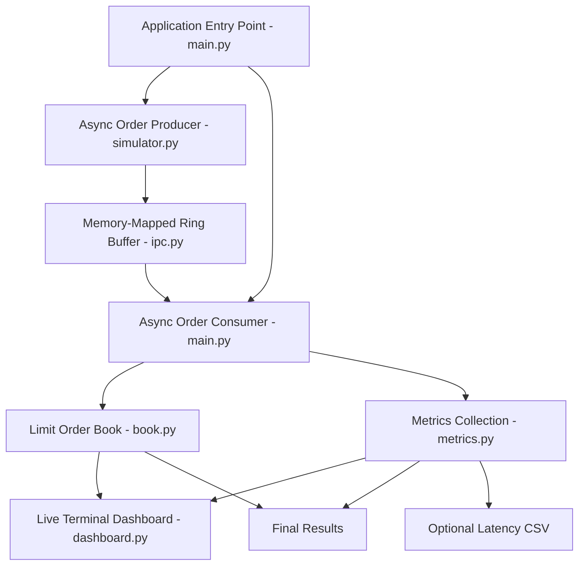

# 2. System Architecture


## 2.1 Overview


ChronosMatch follows a simple producer-consumer architecture. An asynchronous producer generates synthetic orders and writes them into a memory-mapped ring buffer. An asynchronous consumer retrieves those orders and sends them to the limit order book for matching.


The metrics module records processing performance, while the dashboard displays the simulation's progress.


Both tasks run within the same Python process using asyncio.


## 2.2 Architecture Diagram





## 2.3 Main Components


### 1. Application Entry Point — main.py


The main file coordinates the complete simulation.


Responsibilities:


- Reads command-line arguments.

- Creates the limit order book and metrics objects.

- Initializes the memory-mapped ring buffer.

- Starts producer and consumer as asynchronous tasks.

- Waits for both tasks to complete.

- Displays final performance statistics.

- Optionally exports latency measurements to CSV.


### 2. Order Producer — simulator.py


The producer generates synthetic buy and sell orders.


Responsibilities:


- Generates random order sides.

- Generates prices around a configurable base price.

- Generates random order quantities.

- Records a timestamp for each order.

- Writes order records into the ring buffer.

- Retries when the ring buffer is full.


The default random seed is 7, allowing repeatable order generation when the other simulation settings remain unchanged.


### 3. Memory-Mapped Ring Buffer — ipc.py


The ring buffer provides temporary storage for transferring order records between the producer and consumer.


It uses:


- Python's mmap module.

- Python's struct module.

- Fixed-size binary records.

- Read and write sequence counters.

- Power-of-two buffer capacity.


The record format is:


```python

struct.Struct("<QBQIQ")

```


This format contains:


| Field | Data type | Size |

|---|---|---:|

| Sequence number | Unsigned 64-bit integer | 8 bytes |

| Side | Unsigned 8-bit integer | 1 byte |

| Price | Unsigned 64-bit integer | 8 bytes |

| Quantity | Unsigned 32-bit integer | 4 bytes |

| Timestamp | Unsigned 64-bit integer | 8 bytes |

| **Total** | | **29 bytes** |


The default ring buffer capacity is 65,536 records.


When the buffer is full, a new write attempt is rejected. The producer retries until the record can be written.


**Important:** This implementation is a single-process producer-consumer demonstration. It does not implement inter-process synchronization or lock-free queue operations.


### 4. Order Consumer — main.py


The consumer retrieves records from the ring buffer.


Responsibilities:


- Checks whether records are available.

- Retrieves the next record.

- Reconstructs the order data.

- Passes the order to the limit order book.

- Records the resulting metrics.

- Updates the dashboard periodically.


If the buffer is empty, the consumer yields control using `asyncio.sleep(0)`.


### 5. Limit Order Book — book.py


The limit order book maintains pending buy and sell orders.


Its implementation uses:


- `heapq` for best-price selection.

- `collections.deque` for FIFO order queues.

- Separate data structures for buy and sell sides.


**BUY matching rule:**


incoming buy order matches when its limit price is greater than or equal to the best available sell price.

**SELL matching rule:**

An incoming sell order matches when its limit price is less than or equal to the best available buy price.

Trades execute at the resting order's price.

If an incoming order cannot be completely filled, its remaining quantity is added to the appropriate side of the order book.

FIFO insertion order maintains time priority at each price level.

### 6. Metrics Module — metrics.py

The metrics module records and calculates simulation performance.

It measures:

- Processing latency.
- Average latency.
- P50 latency.
- P95 latency.
- P99 latency.
- Total processed orders.
- Throughput.
- Filled quantity.

Latency is calculated from the producer timestamp to the timestamp taken after the consumer has processed the order and recorded its metrics.

Therefore, the measurement includes more than just the matching operation.

### 7. Dashboard — dashboard.py

The dashboard provides a live terminal view of the simulation.

It displays:

- Progress percentage.
- Elapsed time.
- Approximate throughput.
- Average and P95 latency.
- Best bid and ask.
- Spread.
- Trade matches.
- Matched quantity.
- Active bid and ask price levels.

The dashboard uses terminal escape sequences and does not require an external visualization package.

## 2.4 Order Processing Sequence

The complete processing sequence is:

1. The application initializes the required components.
2. The producer generates an order.
3. A timestamp is captured.
4. The order is packed into a 29-byte binary record.
5. The producer writes the record to the ring buffer.
6. The consumer retrieves the record.
7. The order is reconstructed.
8. The limit order book checks whether a match is possible.
9. Matching or order-book insertion takes place.
10. Metrics are recorded.
11. The dashboard is refreshed periodically.
12. Final results are displayed after all expected orders are processed.

## 2.5 Price-Time Priority Example

Consider the following sell orders:

| Order | Side | Price | Quantity |
|---|---|---:|---:|
| S1 | SELL | 100 | 10 |
| S2 | SELL | 101 | 15 |

Now an incoming buy order arrives:

| Order | Side | Price | Quantity |
|---|---|---:|---:|
| B1 | BUY | 102 | 20 |

The incoming buy order can match both sell orders because its limit price is higher than their asking prices.

Execution:

| Match | Execution Price | Quantity |
|---|---:|---:|
| B1 with S1 | 100 | 10 |
| B1 with S2 | 101 | 10 |

The remaining quantity of S2 is 5.

This example demonstrates price priority first and FIFO insertion order for orders at the same price level.

## 2.6 Architecture Summary

| Component | Responsibility |
|---|---|
| main.py | Application orchestration |
| simulator.py | Synthetic order generation |
| ipc.py | Memory-mapped record transfer |
| book.py | Order matching and order-book management |
| metrics.py | Latency and throughput calculations |
| dashboard.py | Live terminal visualization |

ChronosMatch combines these components into a self-contained educational trading-engine simulation.


